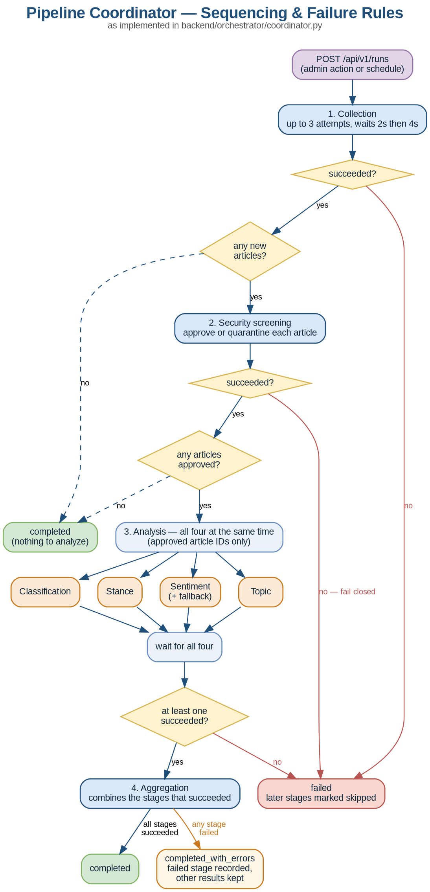

# Pipeline Coordinator (SS-4)

**Status: running end to end, verified against the live database.**
All eight stages have real agents: collection, security, classification,
topic, sentiment, stance, comment sentiment and aggregation. Topic,
sentiment, comment sentiment and stance fall back to stubs on machines
missing their model, libraries or LLM key — see
[Which agents are real](#which-agents-are-real). 234 offline tests.

Latest live run, 2026-11-22: run #80 collected 7 new articles, passed
all 7 through security, and every stage succeeded, with RoBERTa
sentiment, the Luna classifier and stance, and comment sentiment
recorded in `pipeline_stage_runs.agent`. Topic ran as a stub there,
because that machine had no BERTopic or no model file. `GET /api/v1/runs`
and `GET /api/v1/runs/<id>` read runs back. See
[Supabase run store](#supabase-run-store).

## What it does

The coordinator runs the agents in a fixed order and records what
happened at each step:

**Collection → Security → Analysis (sentiment, topic, classification, stance, comment sentiment, all at once) → Aggregation**

It moves *control*, not data. Agents read articles from the database and
write their own results back; the coordinator only tells each agent when
to start, passes along article IDs, and records whether each stage worked.



## Failure rules

| Stage | Attempts | If it still fails |
|---|---|---|
| Collection | 3 (waits 2s, then 4s) | Run **fails** — nothing to analyze. Later stages marked `skipped`. |
| Security | 2 | Run **fails** and analysis is skipped, so unscreened content is never analyzed. |
| Sentiment | 2, then fallback agent | Stage marked `failed`; the other analysis stages keep going. |
| Topic / Classification / Stance / Comment sentiment | 2 (classification then falls back to the keyword scorer) | Stage marked `failed`; the other analysis stages keep going. |
| Aggregation | 2 | Run is `completed_with_errors`; analysis results are kept. |

Each run ends in one of three states:

- `completed` — every stage that needed to run succeeded
- `completed_with_errors` — finished, but at least one stage failed (the rest of the results are kept)
- `failed` — stopped early, or no analysis stage succeeded

A run is not left stuck at `running` while the server is up: if the
coordinator itself hits an error, or the database rejects the run's
stage rows when it starts, the run is recorded as `failed` with the
error in its notes. (The second case used to leave a run at `running`:
run #66 sat there, because the table's check lacked the
`comment_sentiment` stage name, until it was closed by hand.) A server that stops mid-run is still a gap — see
[Known limitations](#known-limitations-and-next-steps).

Retry counts and wait times are starting values in `orchestrator/retry.py`.

## Code layout

```
backend/
  app.py                    Flask app; registers the /api/v1/runs endpoints
  run_pipeline.py           terminal demo — runs the pipeline once and prints a table
  orchestrator/
    stages.py               stage names, order, and status values
    models.py               run/stage records (match the proposed tables column for column)
    agents.py               the agent contract + stub agents
    registry.py             which agent runs each stage — real agents or stubs
    retry.py                attempts and backoff per stage
    coordinator.py          sequencing and failure handling
    runner.py               runs the pipeline on a background thread
    routes.py               API endpoints
    store.py                the RunStore interface + the in-memory implementation
    supabase_store.py       Supabase implementation (verified against the real database)
  agents/                   the team's agent implementations, one package per owner
    supabase_client.py      the one Supabase client the agents share
    adapters.py             the Agent subclasses the coordinator calls
    collection/             fetch, dedupe, keyword + LLM relevance check, preprocess
    security/               sanitization filter + its adversarial suite
    classification/         stakeholder and source-type classifiers
    topic/                  saved BERTopic model + its offline tests
    sentiment/              article sentiment (RoBERTa, VADER fallback) and comment sentiment
    stance/                 stance toward GAI in education (Luna LLM) + its validation kit
    aggregation/            the dashboard's sentiment figures
  tests/                    the offline suite (with agents/topic: 234 tests)
  e2e/                      end-to-end checks against a real database, run only when named
  .env                      credentials — gitignored, never commit
frontend/                   React dashboard — see [Front end](#front-end)
docs/
  pipeline_tables.sql       the originally proposed SQL; see the note in its header
supabase/
  migrations/               schema changes applied with `supabase db push`
pyrightconfig.json          type-checker settings
```

The split matters: `orchestrator/` never imports an agent, and
`agents/<stage>/` is its owner's code. `agents/adapters.py` is the only
file that knows about both, so an owner can keep working in their own
package without touching sequencing code.

## Which agents are real

| Stage | Agent | Notes |
|---|---|---|
| Collection | **real** | `agents/collection/` — NewsAPI, GNews and eight RSS feeds, then dedupe, a keyword filter, an LLM relevance check and body extraction |
| Security | **real** | `agents/security/` — sanitization filter; see below |
| Classification | **real** | `agents/classification/` — LLM classifier when `TRUSSED_API_KEY` is set, keyword scorer otherwise or as its fallback |
| Sentiment | **real** where transformers and vaderSentiment are installed | `agents/sentiment/sentiment_agent.py` — RoBERTa (`roberta_news_v2`) with VADER as the fallback |
| Topic | **real** where its model is | `agents/topic/` — topics from a saved BERTopic model, stored in the repo with Git LFS; a stub on machines without it — see below |
| Stance | **real** where `TRUSSED_API_KEY` and `TRUSSED_BASE_URL` are set | `agents/stance/stance_agent.py` — favor / against / neutral toward GAI in education, from the Luna LLM |
| Comment sentiment | **real** where transformers and vaderSentiment are installed | `agents/sentiment/comment_sentiment_agent.py` — Guardian reader comments that security passed |
| Aggregation | **real** | `agents/aggregation/` — sentiment figures over the corpus; `/results` recomputes them per request and the stage stores nothing |

`build_default_registry(live=...)` chooses. `live=None` (the default)
decides from the environment: real agents when Supabase is configured,
stubs otherwise, so the demo and the tests work on a machine with no
`.env`. Even with `live=True`, topic, sentiment and comment sentiment
stay stubs where their model or libraries are missing, and stance where
the LLM key is, rather than fail every run. (Without the LLM key,
classification uses its keyword scorer and collection fails up front.) The run console's
"stub" tag shows which stages were stubbed in a given run.

### Collection

Fetch → store → keyword filter → LLM relevance check → preprocess, then
report the IDs.

The keyword filter is a loose recall pass. The LLM check (Luna, the
model the LLM classifier uses) sets `llm_relevant`, and preprocess only
downloads articles it confirmed. So **collection needs
`TRUSSED_API_KEY` and `TRUSSED_BASE_URL`**: without them no run can
produce an article, and the stage fails before fetching rather than
spend API quota first. If every LLM call fails, it raises too.

It returns only the articles it stored **that analysis can actually
use**: confirmed relevant by the LLM and preprocessed successfully. An
article whose page could not be downloaded has no `clean_content`, and
every analysis agent reads `clean_content`, so passing its ID on would
just produce a failure in every analysis stage further down.

A run that passes nothing on finishes early, and its note says why,
from the counts collection reports: "Fetched 12 article(s); all were
already stored", "Stored 9 new article(s); none were relevant", and so
on. That is correct, not a fault — but it means you cannot exercise the
rest of the pipeline that way once the corpus is current. `--backlog`
(below) exists for that, and so does `POST /api/v1/runs` with
`{"backlog": true}` (the dashboard's **Run on 5 stored articles**),
which sets `RunContext.backlog_limit` to 5 for that one run.

### Security

Screens each collected article's title and body through
`agents/security/text_filter.py`. Anything the filter rejects is left
out of `approved_ids`, so no analysis agent is handed it.

**The filter scores 44/45 against its own adversarial suite**
(`python -m agents.security.adversarial_test_set` from `backend/`), up
from 29/45 before the security owners added
`agents/security/injection_normalization.py`. That checks each text as
written, normalized (zero-width characters, homoglyphs, leetspeak and
separators folded away), reversed, and with any base64 decoded. The one
miss is a full name, which no pattern can catch; the filter's own docs
say it needs NER.

The filter's length cap, `MAX_TEXT_LENGTH`, is 50,000 characters. The
longest article today is 101,377, so `SecurityAgent` raises the cap to
200,000 for article bodies and leaves the filter's own default
untouched for other callers.

Rejections, of articles and comments, are logged at WARNING, counted
by reason in the stage's summary, and written to the
`quarantined_content` table through `agents/security/quarantine.py`
(the shared Supabase client). That write is best-effort: if it fails,
the stage logs a warning and carries on. The table has no migration in
this repo.

One thing it deliberately does not do:

- **The redacted text is not written back.** The filter redacts emails,
  phone numbers, SSNs and addresses in the text it returns, but analysis
  agents read `clean_content` straight from the database and so still
  see the unredacted article. Screening currently decides pass or
  quarantine, nothing more.

Security also screens reader comments: up to 2,000 unscreened comments
per run (`COMMENT_BATCH`), marked `screened` and, if rejected,
`quarantined`. Unlike articles this never fails the stage: an
unscreened comment is already hidden by row-level security, so a bug
there must not take article analysis down with it.

### Classification

Writes `stakeholder_category` and `source_type` to
`classification_results` for the approved articles, tagged with which
classifier produced the row so the two can be compared (classification
README, F.10).

The LLM classifier runs as the primary agent with the keyword scorer as
its fallback **only when `TRUSSED_API_KEY` and `TRUSSED_BASE_URL` hold
real values**. A placeholder copied from `.env.example` counts as
unset — otherwise every run burns its retries on a 401 before falling
back.

### Topic

Assigns each approved article a topic from a **saved** BERTopic model
and inserts it into `topic_results`, with a permanent topic ID
(`stable_topic_id`, T001–T005) and the model's version. It never trains
during a run: the model file must match the checksum registered in
`agents/topic/topic_catalog.json`, or the stage fails. Existing
assignments are kept, not overwritten. See
`agents/topic/TOPIC_IDENTITY.md`.

**The model file is stored with Git LFS** in
`backend/agents/topic/models/` (441 MB), so Git LFS must be installed
to get it. A clone made without Git LFS has a small pointer file there
instead. The registry uses the topic agent only where BERTopic is
installed and the real model file is in that folder; anywhere else,
pointer included, topic stays a stub rather than fail every run, and a
pointer logs a warning saying to run `git lfs pull`. A file whose
checksum is not registered still fails the stage loudly.

BERTopic and its stack (~2GB with torch) are in `requirements.txt`. The
adapter imports the module only inside `run()`, so building the
registry, the tests and the dev server never load it.
`pyrightconfig.json` still excludes the package; its offline tests run
with `python -m pytest agents/topic`.

### Sentiment

`agents/sentiment/sentiment_agent.py` labels each approved article with a
news-trained RoBERTa model, with VADER as the fallback. It reads the
run's articles from Supabase, skips ones that already have a result from
that method, and writes `sentiment_results` itself. Nothing loads at
import; the models load on first use, and the first RoBERTa run
downloads over 1 GB.

### Stance

`agents/stance/stance_agent.py` asks the Luna LLM (the classifier's
model) which side each approved article comes down on toward
**generative AI in education**: `favor`, `against` or `neutral`, the
three labels of SemEval-2016 Task 6. Sentiment says how an article
sounds; stance says which side it takes. It writes `stance_results`
with the target and method on every row, so a second target can sit
beside the first later, and skips articles that already have a row
from that method. The confidence is the model's own estimate, not a
calibrated probability.

It needs `TRUSSED_API_KEY` and `TRUSSED_BASE_URL`; without them there
is no fallback and the stage is a stub. To label every article with no
stance yet, outside a run: `python -m agents.stance.stance_agent --save`.

**Not yet checked against human labels.** `agents/stance/validation.py`
samples articles to hand-label and scores them with Cohen's kappa; the
steps are in `NEXT_STEPS.md`, section 2.

### Comment sentiment

`agents/sentiment/comment_sentiment_agent.py` labels the Guardian
reader comments on the run's approved articles as positive, neutral or
negative with a 3-class RoBERTa model (`hartmann_3`), and writes
`comment_sentiment_results`. It only takes comments security passed
(`screened`, not `quarantined`), saves every 256 comments, and skips
comments that already have a result. No run stage fetches comments:
`python -m agents.collection.guardian_comments` does, as a separate
pass after collection.

The stage name needed
`supabase/migrations/20261108000200_comment_sentiment_stage.sql`, which
has been applied; runs since #76 record it.

## Running it

From the `backend` folder:

```
pip install -r requirements-dev.txt

python run_pipeline.py                      # normal run (stub agents, no database)
python run_pipeline.py --fail topic         # one analysis agent fails
python run_pipeline.py --fail sentiment     # sentiment fails, fallback takes over
python run_pipeline.py --fail security      # screening fails, analysis skipped
python run_pipeline.py --flaky collection   # fails once, succeeds on retry

python run_pipeline.py --live               # the real agents: fetches news, downloads
                                            # article pages, writes results
python run_pipeline.py --live --backlog     # the real agents over articles already
                                            # stored — no API quota, no downloads

python -m pytest tests agents/topic         # run the tests
python -m pyright backend/                  # type check (from the repo root)
```

`--backlog` is how to exercise the pipeline against the real corpus.
Plain `--live` fetches from the news APIs and downloads every new
article's page at one second apiece, and once the corpus is current it
usually collects nothing and the run finishes early.

`run_pipeline.py` always keeps run status in memory, never in
`pipeline_runs`, so a demo run does not show up in the dashboard's
history.

Through the API (with `python app.py` running):

```
curl -X POST http://localhost:5000/api/v1/runs      # start a run -> 202 with the run ID
curl http://localhost:5000/api/v1/runs/1            # progress of run 1, stage by stage
curl http://localhost:5000/api/v1/runs              # recent runs, newest first
```

Starting a run while another is active returns `409` with the active run's ID.

## Testing plan

234 offline tests, none of which touch the network: stage order, the five
analysis agents running at the same time, each failure rule, the API,
the Supabase store against a fake client, the adapters against fake
agent modules, and the end-to-end suite's own safety rails. The suite
passes `live=False`, so it behaves the same with or without credentials
in `backend/.env`. Plain `pytest` runs them (`backend/pytest.ini`).

The end-to-end suite in `backend/e2e/` checks the real thing: a pipeline
run over 5 stored articles through the API, the results endpoint against
Supabase's own counts, the dashboard in Chromium, and with `--collect` a
real collection run. It writes to the database it is pointed at, so it
runs only when named. Design:
[`docs/superpowers/specs/2026-10-08-e2e-testing-design.md`](superpowers/specs/2026-10-08-e2e-testing-design.md);
latest report: [`docs/testing/e2e-test-report.md`](testing/e2e-test-report.md).

Tests get added alongside the features they cover:

| When we... | Add tests for | |
|---|---|---|
| switch to the Supabase tables | the Supabase store, and a check that the SQL and code stay in sync | **landed** |
| plug in the real agents | malformed output, duplicate articles, quarantined articles, misbehaving agents | **landed** |
| have the dashboard poll run status | the run-list and run-status endpoints | **landed** |
| settle the retry settings | retry counts and backoff timing | waiting |
| add scheduled runs or single-stage re-runs | run lifecycle rules | waiting |

The two groups still waiting are listed in `tests-to-add-later/README.txt`.
Their tests were never committed, so they get written when their trigger
is met.

## For agent owners: plugging in your agent

1. Put your code in `backend/agents/<your stage>/`. It stays yours —
   nothing in `orchestrator/` imports it.
2. Add an `Agent` subclass to `agents/adapters.py` that calls your code
   and implements `run(ctx)`.
3. `ctx` holds `run_id`, `article_ids` (collected), `approved_ids`
   (passed security), and `completed_analysis` (for aggregation). It
   never holds article text — read what you need from the database.
4. Read and write the database through `agents/supabase_client.py`'s
   `get_client()`. Don't build your own client and don't call
   `load_dotenv()` at import time: your module gets imported by the
   test suite and by the app, not just run as a script.
5. Write your results to your own table, then return a small summary dict.
6. If something goes wrong, **raise an exception**. Don't retry inside
   your agent and don't swallow errors — the coordinator handles retries,
   fallbacks, and recording the failure. This is the rule the standalone
   scripts break most often: catching an error and printing it makes a
   failed stage look like a stage that found nothing.
7. Register it in `build_default_registry()` in `registry.py`, in the
   `live` branch.
8. Keep your work inside the IDs you were given. `ctx.approved_ids` is
   what security passed; a stage that processes the whole table instead
   is not doing the run it was asked for.

What each stage must return (the coordinator checks this and treats
anything else as a failure):

| Stage | Return value |
|---|---|
| Collection | `{"article_ids": [...]}` — IDs of the articles stored this run |
| Security | `{"approved_ids": [...], "quarantined_ids": [...]}` — approved IDs must come from the collected ones |
| Sentiment / Topic / Classification / Stance / Comment sentiment | any dict, e.g. `{"processed": 42}` |
| Aggregation | any dict |

Example:

```python
from orchestrator.agents import Agent

class SentimentAgent(Agent):
    name = "sentiment"

    def run(self, ctx):
        # read articles ctx.approved_ids from the database,
        # classify them, write rows to sentiment_results
        return {"processed": len(ctx.approved_ids)}
```

```python
# registry.py
registry.register(SENTIMENT, SentimentAgent(), fallback=agents.stub_fallback(SENTIMENT))
```

## Front end

`frontend/` is a React (Vite) dashboard that reads everything through
the Flask API; it never talks to Supabase. Two tabs:

- **Dashboard** — the filter panel (date range, source type,
  stakeholder, topic, keyword), a headline naming the most negative
  stakeholder and topic, the sentiment, stance and "How readers react"
  donuts, the top-topics bar, "Sentiment by month" (by quarter past 20
  months), sentiment split by stakeholder and by topic, the article
  table with Export CSV, and comment search. Data: `GET /api/v1/results`
  and `GET /api/v1/search/comments`, re-fetched when a filter changes.
- **Pipeline runs** (`components/AdminConsole.jsx`) — the run list
  with each stage's status, agent and "stub" tag, and buttons to start
  a run or a run on 5 stored articles (`POST /api/v1/runs`, with
  `{"backlog": true}` for the second). Data: `GET /api/v1/runs` and
  `GET /api/v1/runs/<id>`.

Layers, so each change has one place to go:

| Layer | File | Does |
|---|---|---|
| Data access | `src/api/apiClient.js` | the only code that calls `fetch`; base URL from `VITE_API_URL` (must end in `/api/v1`, default `http://localhost:5000/api/v1`) |
| State | `src/state/ViewStateContext.jsx` | filters, open tab, results, loading and errors; filters and tab mirrored in the URL (`src/urlState.js`) so a view can be shared |
| Presentation | `src/components/`, `src/styles.css` | the views; charts with Recharts; the dark theme follows the OS setting |

Run it with `npm install` and `npm run dev` in `frontend/`, alongside
`python app.py` (serves http://localhost:5173). `npm test` runs the 20
tests for the CSV export, URL state and month binning with Node's
built-in runner. The end-to-end suite (`backend/e2e/`) checks the
dashboard in Chromium against the real API.

The run console starts **real** runs on whatever database the backend
points at, and there is no login (dropped from scope on 2026-11-08) —
see [Known limitations](#known-limitations-and-next-steps).

## Supabase run store

`app.py` picks the store at startup (`build_run_store()`): Supabase when
`SUPABASE_URL` and `SUPABASE_KEY` are both set, in-memory otherwise. The
fallback keeps the app startable for front-end work without credentials;
in-memory runs are lost when the process stops.

### Setup

1. `pip install -r requirements.txt`
2. Create `backend/.env` from `.env.example` and fill in the key.
   It is gitignored — **never commit it.**

```
SUPABASE_URL=https://uivjesdostuaihbjpdjr.supabase.co
SUPABASE_KEY=sb_secret_...
```

Use the **secret** key. The publishable (`sb_publishable_…`) key has no
privileges on the run tables — writes fail with `42501 permission
denied`. Postgres suggests fixing that with `GRANT INSERT … TO anon`;
don't. The publishable key ships to browsers, so that would let anyone
forge pipeline runs — or, for `articles`, inject content straight into
the corpus the analysis agents read.

### Which key unlocks what

Both measured against the live project:

| | publishable key | secret key |
|---|---|---|
| Read `articles` | yes | yes |
| **Insert `articles`** (collection) | **no — 42501** | yes |
| Read `pipeline_stage_runs` | **no — 42501** | yes |
| Write `classification_results` | yes | yes |
| Write `pipeline_runs` / `pipeline_stage_runs` | **no — 42501** | yes |

With a publishable key the pipeline runs, but only in `--backlog` mode,
and nothing about the run is recorded: `build_run_store()` falls back
to `InMemoryRunStore` and the history is lost when the process stops.
Collection fails all three attempts and the run ends `failed` with the
Postgres hint in `error_detail`. That is a confusing state to debug,
because most of a backlog run looks healthy — so `build_run_store()`
says at startup when the anon key is the only one set.

### Two things that look like bugs and are not

- **`SUPABASE_URL` set to the dashboard page.** Copying the project URL
  out of the browser gives
  `https://supabase.com/dashboard/project/<ref>`, which serves an HTML
  login page. `agents/supabase_client.py` rejects it at startup with a
  message naming the problem; the run store used to surface it much
  later as `TypeError: string indices must be integers`. The value you
  want is `https://<ref>.supabase.co`.
- **A placeholder key.** Every key in `.env.example` ships with a
  `your-…` value. `agents/config.py` treats those as unset, so a source
  or classifier is skipped rather than making requests that all come
  back 401.

`SUPABASE_URL` is the API endpoint, not the dashboard page. A dashboard
URL returns an HTML login page, which surfaces as a confusing
`TypeError: string indices must be integers`.

### Verified

Every `RunStore` method round-trips against the real database: create,
read, list, and update, for both runs and stages, with timestamps
parsing back to `datetime`, including the (then four) analysis stages
writing concurrently.

**Any `RunStore` must be thread-safe.** The coordinator runs the five
analysis stages in a `ThreadPoolExecutor`, so all five update their rows
at the same time. `SupabaseRunStore` holds one HTTP connection, which
cannot be shared across threads, so every method takes a lock; without
it the parallel stages all fail with `ReadError: [WinError 10035]` while
collection and security pass, because those run sequentially. The writes
are short, so serialising them costs nothing next to the agents' work.

### The deployed schema differs from `pipeline_tables.sql`

The tables were created from the *original* proposal, before the team
agreed the changes listed at the top of that file. What is deployed:

| | `pipeline_tables.sql` says | deployed table enforces |
|---|---|---|
| `stage_name` | includes `security`, final stage `aggregation` | **fixed** — see below |
| `attempt` | `default 0` | `default 1`, `check (attempt >= 1)` |
| unique key | `(run_id, stage_name)` | `(run_id, stage_name, attempt)` |
| `articles_collected` | nullable, no default | `default 0` |
| `pipeline_runs` | — | extra `one_running_pipeline` constraint |

The `stage_name` check originally rejected `security` and `aggregation`,
which killed every run at the security stage.
`supabase/migrations/20260924000153_align_stage_name_constraint.sql`
fixes it and **has been applied**.

`supabase/migrations/20261025000100_stage_agent.sql` adds two nullable
columns, `agent` and `stub`: which agent ran each stage (the fallback's
name if the fallback saved it) and whether it was a placeholder. The
pipeline console's "stub" tag reads them. **It must be applied before
the code that writes them is deployed**: until then, every stage update
names a column the table doesn't have, and runs fail. Rows from earlier
runs keep nulls and show no tag.

`create_stage` works with either `attempt` default, since it omits the
column and lets the database decide.

### The migration history is out of sync

That migration was applied through the dashboard SQL editor, not
`supabase db push`, because push refuses:

> Remote migration versions not found in local migrations directory.

The remote database records twelve migrations that have no files in this
repo — they were applied from elsewhere. **Do not run the
`supabase migration repair --status reverted ...` command the CLI
suggests.** It does not undo anything; it deletes those rows from the
remote history, so a teammate whose repo *does* hold those twelve files
would have `db push` try to re-run all of them against the live
database.

The fix is `supabase db pull` (needs Docker running), which captures the
real remote schema locally and gets the two histories agreeing. Until
someone does that, no repo describes the deployed schema — which is how
`security` and `aggregation` stayed missing for as long as they did.
The migration file is idempotent, so re-applying it after a pull is
harmless.

Two smaller mismatches are left open for the team:

- **`attempt` semantics.** A pending stage reads `attempt=0` from the
  in-memory store and `attempt=1` from Supabase. Harmless once a stage
  runs — the coordinator overwrites it — but the two stores are not
  identical for `pending` and `skipped` stages.
- **`articles_collected` defaults to 0**, so "collected nothing" and
  "not known yet" cannot be told apart.

`tests/test_supabase_store.py` covers the store against a fake client,
and `tests/test_schema_sync.py` keeps `pipeline_tables.sql` and the code
in step. Nothing yet fails when the *deployed* schema drifts from the
code — a missing migration still shows up only as a failed run.

## Known limitations and next steps

- **Stance labels are unvalidated.** Nobody has compared them with
  human labels yet; the kit is ready (see [Stance](#stance)). Sentiment
  and comment sentiment are stubs wherever `transformers` or
  `vaderSentiment` is not installed, and stance wherever the LLM key is
  missing. See [Which agents are real](#which-agents-are-real).
- **The topic stage only runs where its model file has been restored.**
  Everywhere else it is a stub, so `topic_results` only grows from runs
  on a machine that has the file.
- **The security filter misses full names** (1 of 45 adversarial
  cases), and `quarantined_content` has no migration in this repo.
- **A collection retry after a late failure collects nothing.** If the
  stage fails after storing its articles (the LLM check, say), the
  retry finds them all already stored and returns no articles, so the
  run finishes early as if there were no news.
- **No per-stage timeout.** An agent that hangs holds up its run. This
  matters more now than it did with stubs: collection downloads article
  pages one second apart, and the LLM classifier makes one call per
  article.
- **Runs live inside the Flask process.** If the server stops mid-run,
  that run stays at `running`. A startup check that marks stale runs as
  `failed` would fix this. With Supabase this also blocks the next run,
  because of the `one_running_pipeline` constraint below.
- **Concurrent runs fail with the wrong error.** `BackgroundRunner`
  guards with an in-process lock, which only covers one Flask process.
  The database's `one_running_pipeline` constraint is the real
  cross-process guard, but a second process hits it as a raw `APIError`
  from the insert rather than `RunAlreadyActive`, so the API returns 500
  where it should return 409.
- **No single-stage re-run yet.** Re-running just one stage needs to know
  which articles belonged to the run — see open question 3.
- **No confirm step on `POST /api/v1/runs`.** Anyone who can reach the app can start a real run. Login (SS-5) was dropped from scope on 2026-11-08 by the professors and sponsors, so the fix is a confirm step or limiting runs to local use.
- **Nothing schedules runs yet.** The `scheduled` trigger type is ready,
  but no scheduler calls it.
- **A backlog run looks like a normal one in `pipeline_runs`.** Its
  `trigger_type` is still `manual` (the column's check allows only
  `manual` and `scheduled`); only its note ("Reused 5 stored
  article(s)...") tells them apart.

## Open questions for the team

1. **Who writes results?** This assumes each agent writes its own result
   rows. If we'd rather agents return results for the coordinator to
   write, only the agent contract changes — not the sequencing.
2. **When does screening happen?** This assumes collection stores articles
   and returns their IDs, and security then approves or quarantines them.
   If nothing should be stored before screening, collection would hand
   over unsaved articles instead — a small change to the collection and
   security contracts.
3. **Add `run_id` to the results tables?** It would let us filter
   results by run and clean up a failed run's partial output. Commented
   out at the bottom of `pipeline_tables.sql`. Now that real agents
   write real rows, this is the difference between "243 topic results"
   and "243 topic results, from which runs".
4. **Stage names — resolved.** The SQL adds `security` and `stance` to
   the original proposal and names the last stage `aggregation` rather
   than `aggregate`. The deployed table had never been updated to match;
   the migration in `supabase/migrations/` has now been applied and runs
   record every stage (eight, since `comment_sentiment`). See
   [Supabase run store](#supabase-run-store).
5. **Quarantine decisions — mostly resolved.** The security stage
   writes them to `quarantined_content` through the Supabase client
   (`agents/security/quarantine.py`). Still missing: a migration for
   that table in this repo.
6. **Should screening write back the redacted text?** The filter
   already produces it; analysis agents currently read the unredacted
   `clean_content`. Writing it to a new column would mean PII never
   reaches the analysis stages, at the cost of a column and a decision
   about which text is canonical.

