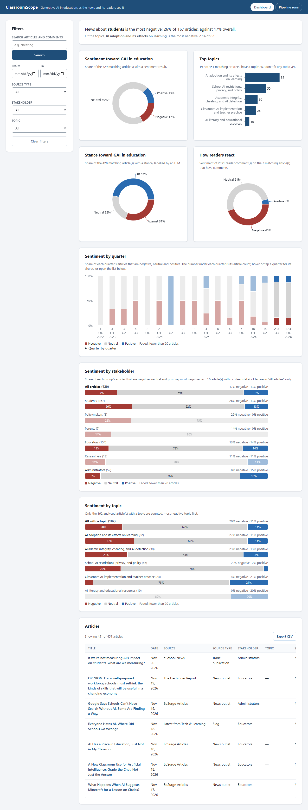
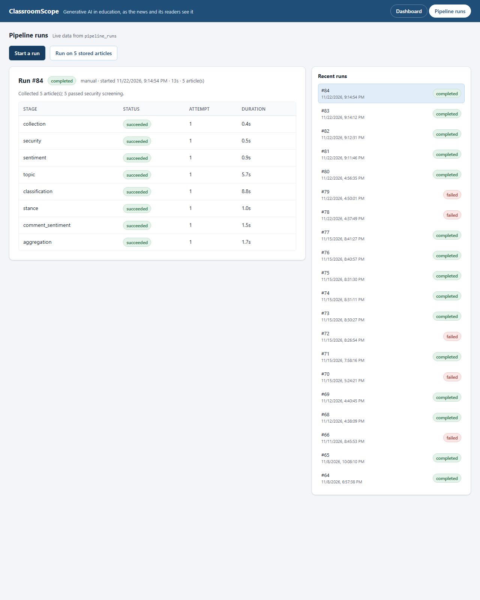

# End-to-end test report: integrated pipeline

**Date:** 2026-11-22 21:13 · **Commit:** `docs-orchestration-refresh` @ `d45dab4` plus the D3/D4 test fix, uncommitted at run time (later `c659b9d`) · **Run by:** Ravi (WBS: lead end-to-end testing)

## Summary

The end-to-end suite ran the real pipeline over 5 stored articles twice,
once through the API and once from the dashboard's "Start a run" button.
It compared the results endpoint and the dashboard with Supabase's own
counts. **12 checks passed and 2 were skipped, in 1 minute 11 seconds.**
The 2 skipped checks are the RSS + GNews collection checks, which run only
with `--collect`. The problems found in the app during the October runs
are listed under Problems found.

The dashboard now shows 5 charts plus the stance and reader-comment
donuts, and the pipeline has 8 stages (`comment_sentiment` was added).
Run #83 had no stub stages: topic, sentiment, stance and comment sentiment
all ran for real. An earlier pass the same evening (results folder
`2026-11-22_211127`) failed two checks, D3 and D4, because the tests were
stale, not the app. D3 expected 7 stage rows, now 8. D4's text locator also
matched the new stance donut's subtitle. With both tests fixed in the
working tree (later committed as `c659b9d`), the re-run passed 12 of 12 (2 skipped: the `--collect`
checks, which only run with that flag).

## Scope

**In scope:** collection (stored articles, and one real RSS + GNews run,
which needs `--collect`), security, classification, topic, the pipeline
stages including sentiment, stance and comment sentiment, the run and
results API, and the dashboard with its admin console.

**Out of scope, and why:**

- Guardian sources, which are not wired into runs yet.
- A separate test database, planned next (see Recommendations).
- Running in CI, which would need the team's secrets.
- Load, performance and cross-browser testing.

## Environment

| | |
|---|---|
| Database | `uivjesdostuaihbjpdjr.supabase.co`, the team's shared project |
| Mode | stored articles only (5 per run); the RSS + GNews collection check is skipped without `--collect` |
| Classifier | LLM (Luna), with the keyword scorer as fallback |
| Topic model | `provisional_topic_model_v2.pkl` (provisional-v2) |

## How to run it

From `backend/`:

```
pip install -r requirements-dev.txt
python -m playwright install chromium    # once per machine, about 150 MB
python -m pytest e2e                     # real pipeline over 5 stored articles,
                                         # the API, and the dashboard in Chromium
python -m pytest e2e --collect           # plus one real RSS + GNews collection
```

Each session writes `backend/e2e/results/<date-time>/results.md` and its
screenshots. **These commands write to the Supabase project in
`backend/.env`.** `E2E_ENV_FILE=<file>` points them at another database,
and the first lines of the output name the database in use. Plain
`python -m pytest`, from `backend/` or the repo root, runs only the
offline tests, which never touch the network.

## Results

| ID | What it checks | Expected | Result | Notes |
|---|---|---|---|---|
| S1–S3 | Supabase is reachable with the configured key; the topic model is real, not a Git LFS pointer; which classifier is primary | The session continues, with the classifier recorded | Pass | LLM primary; provisional-v2 loaded |
| H1 | The test backend answers `/api/v1/health`, and the production frontend build loads | `{"status": "ok"}`; the page shows "ClassroomScope" | Pass | |
| P1 | Starting a run through the API | 202 at once; run `running`, every stage pending (collection may already be running) | Pass | run #83 |
| P2 | The run finishes | `completed`; all 8 stages succeeded | Pass | run #83 took 39 s; no stub stages |
| P3 | A second start while one is running | Refused with 409, naming the active run | Pass | |
| P4 | The run list | The new run first; nothing active once it has finished | Pass | |
| P5 | The database itself, read directly | The run and its stage rows final; classification rows written during the run for exactly 5 analysable articles; a topic row for each | Pass | articles 36, 45, 47, 49, 51 |
| R1 | `/api/v1/results` topic counts and sentiment share | Equal to the counts worked out from the raw tables: one topic per analysable article, the newest row, none means unassigned | Pass | 199 articles with a topic, 252 unassigned; sentiment over 429 articles |
| D1 | The dashboard in Chromium | No console errors; the topic and sentiment figures match the database; no label cut off | Pass | screenshot below |
| D2 | The Pipeline runs tab | The API run listed, its badge reading exactly `completed` | Pass | |
| D3 | "Start a run" on the dashboard | The button disables; stages move from running to succeeded; the run ends `completed` | Pass | run #84 |
| D4 | A search that matches one sentiment | Labels only its slice of the sentiment donut | Pass | |
| C1 | A real RSS + GNews collection run | Completes, whether or not there was new on-topic news | Skipped | real collection runs only with `--collect` |
| C2 | Every article C1 reports | Stored as relevant, fully downloaded, and classified | Skipped | real collection runs only with `--collect` |

## Problems found

### 1. A run that stored new articles says "No new articles were collected" (low; fixed)

**What happens:** when collection fetches articles it hasn't seen before
but none of them are relevant, it stores them and reports no usable
articles. The run then ends with the note "No new articles were
collected." Anyone reading the run history concludes that nothing was
fetched.

**To reproduce:** run `python -m pytest e2e -k c1 --collect` at a time
when the feeds' only new items are off-topic.

**Evidence:** run #23 (Oct 8) stored articles 6156 and 6157, both
off-topic items from The Conversation's RSS feed, yet
`pipeline_runs.notes` reads "No new articles were collected." The suite's
results that session showed `New articles: 6156, 6157`. Run #12 on Oct 4
did the same with 9 articles.

**Suggested fix:** have the note say how many articles were stored and
how many were relevant, for example "9 new articles, none relevant"
(item 4 in `NEXT_STEPS.md`).

**Fixed:** since commit `2590f81` the note reads "Stored N new
article(s); none were relevant."

### 2. The dashboard's article note gives a stale count (low; gone since the redesign)

**What happens:** the Articles section reads "The pipeline has 814 real
articles". The database holds 2,282, of which 328 are analysable.

**Evidence:** the October D1 screenshot, since replaced.

**Suggested fix:** the dashboard MVP replaces this placeholder table with
real articles. It has: the redesign shows the real article list (see the
rerun below).

### 3. In the test suite, now fixed: P5 read the database too late

**What happened:** pytest runs the browser tests first, to share their
browser setup. D3's run therefore re-classified the same 5 stored
articles before P5 looked, and P5 found none in its own run's time
window.

**Fix:** the shared run fixture now records the database facts as soon as
its run finishes (commit `6569a39`).

### Observations, not defects

- **`POST /api/v1/runs` can already show collection as running.** The
  response reads the stage list after the run's thread has started. P1
  allows for this.
- **252 articles have no topic and 199 have one (2026-11-22 run).** That's
  how the provisional-v2 model predicts. The `auto-v1` candidate trained with
  `train_auto.py` left 34% unassigned in training. This is a decision for
  the topic owner.
- **Every e2e run prints a few warnings:** two DeprecationWarnings from
  inside supabase-py 2.31, and ResourceWarnings for Supabase connections
  the app never closes. They're harmless today and would go away with a
  supabase-py upgrade and closing clients on shutdown.

## History: rerun after the dashboard redesign (2026-10-13)

The dashboard MVP (filters, keyword search, redesign) merged after the
report's first run (October 8), and D1 failed against it: the topic line, the axis
labels and the Pipeline runs console had all changed. D1–D3 and R1 were
rewritten for it, then run again: **R1, D1, D2 and D3 pass** (branch
`fix-e2e-dashboard-selectors`, runs #49 and #50, both `completed`, 7
stages succeeded).

Two things changed in what the checks assert:

- **R1 and D1 now count per article, not per row.** The corpus gives each
  analysable article one topic (its newest row) and counts articles
  with none as unassigned. Counting rows disagreed with the API by 5, the
  articles with no topic row yet. The API was right; the expectation was
  rewritten from the raw tables.
- **D1 also checks the article table:** "Showing N of N articles" and one
  row per article, matching the database. That run showed 159 of 333
  articles with a topic and 174 without.

D2 and D3 now also fail at once on a run that ends `completed with
errors` or `failed`, instead of waiting five minutes, and D3 waits for the
console to load before clicking.

## History: aggregation lands (2026-10-13)

The aggregation stage is real now, and the dashboard's sentiment donut
shows `sentiment_results` instead of hardcoded figures. R1 checks the
API's sentiment share against the raw table (one result per analysable
article, RoBERTa's row first), and D1 checks the donut's labels against
the same numbers. The full suite passed, 11 of 11 without `--collect`
(runs #51 and #52, both `completed`, with aggregation `succeeded`): 323
analysed articles, 72% neutral, 15% negative, 12% positive.

P2's note began naming the stages the registry actually stubbed. On the
machine that ran it then, that was sentiment (its libraries were not
installed there) and stance (not yet built). The 2026-11-22 runs stubbed
none.

## Database footprint

| Table | Before | After | Change |
|---|---|---|---|
| pipeline_runs | 73 | 75 | +2 |
| pipeline_stage_runs | 516 | 532 | +16 |
| articles | 3403 | 3403 | 0 |
| classification_results | 946 | 946 | 0 |
| topic_results | 436 | 436 | 0 |

- Classification rows re-written: 5
- Runs created: #83, #84
- New articles: none

One run of the suite without `--collect` makes two pipeline runs (#83
through the API, #84 from the dashboard), which show up in the team's
run history. A run with `--collect` makes a third, collecting run. Every
run also re-writes the LLM classifications of the same 5 stored articles.

## Recommendations

1. **A separate Supabase project for testing,** so these checks stop
   writing to the team's data. The suite needs no change for it: put the
   test project's keys in `backend/.env.test` and run with
   `E2E_ENV_FILE=.env.test`. The project does need setting up first:
   the team's schema, and a copy of at least 5 stored articles that are
   relevant and fully downloaded, with their topic rows. Every run over
   stored articles picks the first 5 such articles, and the dashboard
   checks run before any run has written a topic row.
2. **Partly done.** The October redesign was handled (see the 2026-10-13 rerun above).
   On 2026-11-22, D3 and D4 broke again: D3 had the stage count
   hardcoded at 7 (it now uses `PIPELINE_ORDER`), and D4 found the
   sentiment donut's subtitle by visible text, which the new stance
   donut's subtitle also matched. `data-testid` attributes on those elements would make
   them survive (see the README's "MVP features" table).
3. **Run `python -m pytest e2e` before merging any PR that touches the
   pipeline or the dashboard.** The 2026-11-22 run took 1 minute 11 seconds.
4. **Topic owner:** look at the unassigned rate (252 unassigned, 199 with a
   topic in the latest run), perhaps starting from the `auto-v1` candidate.




