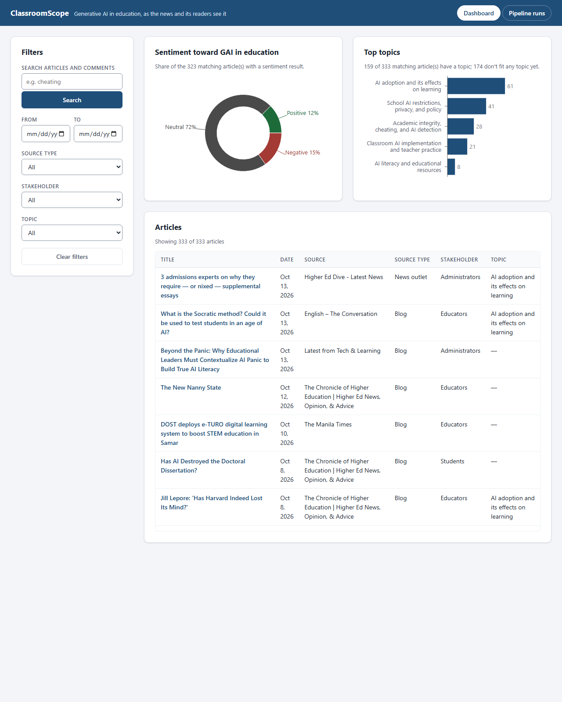
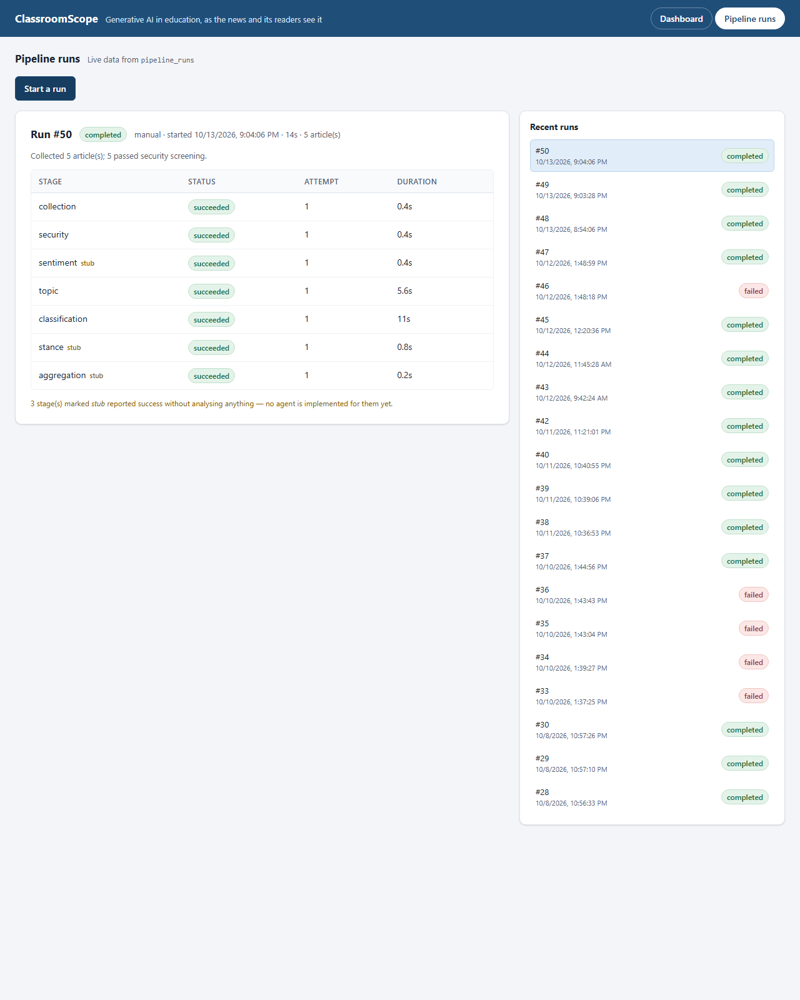

# End-to-end test report: integrated pipeline

**Date:** 2026-10-08 22:56 · **Commit:** `e2e-testing` @ `6569a39` · **Run by:** Ravi (WBS: lead end-to-end testing)

## Summary

The end-to-end suite ran the real pipeline over 5 stored articles twice,
once through the API and once from the dashboard's "Start a run" button.
It compared the results endpoint and the dashboard with Supabase's own
counts, and ran one real collection from RSS and GNews. **All 13 checks
passed, in 1 minute 56 seconds.** While the suite was being built, its
runs also turned up two low-severity problems in the app: a run note that
says no articles were collected when some were, and a stale article count
on the dashboard. A problem in the suite itself was found and fixed
before this run.

## Scope

**In scope:** collection (stored articles, and one real RSS + GNews run),
security, classification, topic, the stub stages as they run today, the
run and results API, and the dashboard with its admin console.

**Out of scope, and why:**

- What sentiment, stance and aggregation will do. They are still stubs;
  the suite checks that they run, not what they produce.
- Guardian sources and reader comments, which are not wired into runs yet.
- A separate test database, planned next (see Recommendations).
- Running in CI, which would need the team's secrets.
- Load, performance and cross-browser testing.

## Environment

| | |
|---|---|
| Database | `uivjesdostuaihbjpdjr.supabase.co`, the team's shared project |
| Mode | stored articles (5 per run) and one real RSS + GNews collection |
| Classifier | LLM (Luna), with the keyword scorer as fallback |
| Topic model | `provisional_topic_model_v2.pkl` (provisional-v2) |
| Software | Python 3.13.7, Node 24.18.0, Playwright 1.63.0 with Chromium 153, Windows 10 |

## How to run it

From `backend/`:

```
pip install -r requirements-dev.txt
python -m playwright install chromium    # once per machine, about 150 MB
python -m pytest e2e                     # real pipeline over 5 stored articles,
                                         # the API, and the dashboard in Chromium
python -m pytest e2e --collect           # plus one real RSS + GNews collection
```

Each session writes `backend/e2e/results/<date-time>/results.md` and its
screenshots. **These commands write to the Supabase project in
`backend/.env`.** `E2E_ENV_FILE=<file>` points them at another database,
and the first lines of the output name the database in use. Plain
`python -m pytest`, from `backend/` or the repo root, runs only the
offline tests, which never touch the network.

## Results

| ID | What it checks | Expected | Result | Notes |
|---|---|---|---|---|
| S1–S3 | Supabase is reachable with the configured key; the topic model is real, not a Git LFS pointer; which classifier is primary | The session continues, with the classifier recorded | Pass | LLM primary; provisional-v2 loaded |
| H1 | The test backend answers `/api/v1/health`, and the production frontend build loads | `{"status": "ok"}`; the page shows "ClassroomScope" | Pass | |
| P1 | Starting a run through the API | 202 at once; run `running`, every stage pending (collection may already be running) | Pass | run #28 |
| P2 | The run finishes | `completed`; all 7 stages succeeded; 5 articles collected and screened | Pass | took 36 s; sentiment, stance and aggregation are stubs |
| P3 | A second start while one is running | Refused with 409, naming the active run | Pass | |
| P4 | The run list | The new run first; nothing active once it has finished | Pass | |
| P5 | The database itself, read directly | The run and its 7 stage rows final; classification rows written during the run for exactly 5 analysable articles; a topic row for each | Pass | articles 36, 45, 47, 49, 51 |
| R1 | `/api/v1/results` topic counts | Equal to the counts worked out from the raw tables: one topic per analysable article, the newest row, none means unassigned | Pass | 135 articles with a topic, 188 unassigned (first run) |
| D1 | The dashboard in Chromium | No console errors; both charts drawn; the topic line, bars, article table and sentiment donut match the database; no label cut off | Pass | screenshot below |
| D2 | The Pipeline runs tab | P's run listed, its badge reading exactly `completed` | Pass | |
| D3 | "Start a run" on the dashboard | The button disables; stages move from running to succeeded; the run ends `completed` | Pass | run #29 |
| C1 | A real RSS + GNews collection run | Completes, whether or not there was new on-topic news | Pass | run #30 found nothing new |
| C2 | Every article C1 reports | Stored as relevant, fully downloaded, and classified | Pass | nothing to check this time |

The run-list endpoint's offline test (U1, two tests in
`backend/tests/test_routes.py`) passes with the rest of the 126 offline
tests.

## Problems found

### 1. A run that stored new articles says "No new articles were collected" (low)

**What happens:** when collection fetches articles it hasn't seen before
but none of them are relevant, it stores them and reports no usable
articles. The run then ends with the note "No new articles were
collected." Anyone reading the run history concludes that nothing was
fetched.

**To reproduce:** run `python -m pytest e2e -k c1 --collect` at a time
when the feeds' only new items are off-topic.

**Evidence:** run #23 (Oct 8) stored articles 6156 and 6157, both
off-topic items from The Conversation's RSS feed, yet
`pipeline_runs.notes` reads "No new articles were collected." The suite's
results that session showed `New articles: 6156, 6157`. Run #12 on Oct 4
did the same with 9 articles.

**Suggested fix:** have the note say how many articles were stored and
how many were relevant, for example "9 new articles, none relevant"
(item 4 in `NEXT_STEPS.md`).

### 2. The dashboard's article note gives a stale count (low; gone since the redesign)

**What happens:** the Articles section reads "The pipeline has 814 real
articles". The database holds 2,282, of which 328 are analysable.

**Evidence:** the D1 screenshot below.

**Suggested fix:** the dashboard MVP replaces this placeholder table with
real articles. It has: the redesign shows the real article list (see the
rerun below).

### 3. In the test suite, now fixed: P5 read the database too late

**What happened:** pytest runs the browser tests first, to share their
browser setup. D3's run therefore re-classified the same 5 stored
articles before P5 looked, and P5 found none in its own run's time
window.

**Fix:** the shared run fixture now records the database facts as soon as
its run finishes (commit `6569a39`). The run in this report includes the
fix.

### Observations, not defects

- **`POST /api/v1/runs` can already show collection as running.** The
  response reads the stage list after the run's thread has started. P1
  allows for this.
- **188 of the 323 analysed articles (58%) have no topic.** That's how the
  provisional-v2 model predicts. The `auto-v1` candidate trained with
  `train_auto.py` left 34% unassigned in training. This is a decision for
  the topic owner.
- **Every e2e run prints a few warnings:** two DeprecationWarnings from
  inside supabase-py 2.31, and ResourceWarnings for Supabase connections
  the app never closes. They're harmless today and would go away with a
  supabase-py upgrade and closing clients on shutdown.

## Rerun after the dashboard redesign (2026-10-13)

The dashboard MVP (filters, keyword search, redesign) merged after this
report's first run, and D1 failed against it: the topic line, the axis
labels and the Pipeline runs console had all changed. D1–D3 and R1 were
rewritten for it, then run again: **R1, D1, D2 and D3 pass** (branch
`fix-e2e-dashboard-selectors`, runs #49 and #50, both `completed`, 7
stages succeeded).

Two things changed in what the checks assert:

- **R1 and D1 now count per article, not per row.** The corpus gives each
  analysable article one topic (its newest row) and counts articles
  with none as unassigned. Counting rows disagreed with the API by 5, the
  articles with no topic row yet. The API was right; the expectation was
  rewritten from the raw tables.
- **D1 also checks the article table:** "Showing N of N articles" and one
  row per article, matching the database. That run showed 159 of 333
  articles with a topic and 174 without.

D2 and D3 now also fail at once on a run that ends `completed with
errors` or `failed`, instead of waiting five minutes, and D3 waits for the
console to load before clicking.

## Aggregation lands (2026-10-13)

The aggregation stage is real now, and the dashboard's sentiment donut
shows `sentiment_results` instead of hardcoded figures. R1 checks the
API's sentiment share against the raw table (one result per analysable
article, RoBERTa's row first), and D1 checks the donut's labels against
the same numbers. The full suite passed, 11 of 11 without `--collect`
(runs #51 and #52, both `completed`, with aggregation `succeeded`): 323
analysed articles, 72% neutral, 15% negative, 12% positive.

P2's note now names the stages the registry actually stubbed. On the
machine that ran it, that was sentiment (its libraries are not installed
there) and stance.

## Database footprint

| Table | Before | After | Change |
|---|---|---|---|
| pipeline_runs | 23 | 26 | +3 |
| pipeline_stage_runs | 152 | 173 | +21 |
| articles | 2282 | 2282 | 0 |
| classification_results | 760 | 760 | 0 |
| topic_results | 323 | 323 | 0 |

- Classification rows re-written: 5
- Runs created: #28, #29, #30
- New articles: none

One full run with `--collect` makes three pipeline runs (#28 through the
API, #29 from the dashboard, #30 collecting), which show up in the team's
run history. It also re-writes the LLM classifications of the same 5
stored articles. This time collection found no new articles; on another
day it may store some.

## Recommendations

1. **A separate Supabase project for testing,** so these checks stop
   writing to the team's data. The suite needs no change for it: put the
   test project's keys in `backend/.env.test` and run with
   `E2E_ENV_FILE=.env.test`. The project does need setting up first:
   the team's schema, and a copy of at least 5 stored articles that are
   relevant and fully downloaded, with their topic rows. Every run over
   stored articles picks the first 5 such articles, and the dashboard
   checks run before any run has written a topic row.
2. **Make the run note tell "nothing fetched" apart from "fetched, none
   relevant"** (problem 1).
3. **Done for the October redesign** (see the rerun below). D1–D3 find
   elements by their visible text, so the next redesign breaks them
   again; `data-testid` attributes on those elements would make them
   survive (see the README's "MVP features" table).
4. **Run `python -m pytest e2e` before merging any PR that touches the
   pipeline or the dashboard.** It takes about 2 minutes.
5. **Topic owner:** look at the 58% unassigned rate, perhaps starting from
   the `auto-v1` candidate.




